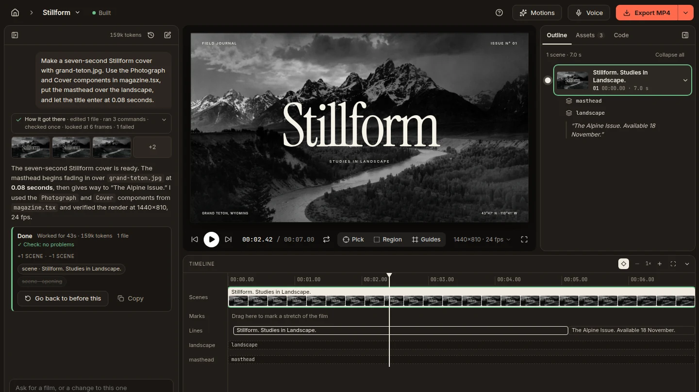

<div align="center">

<a href="https://openmotion.studio/"></a>

# OpenMotionStudio

**You have the eye. Now you have the hands.**

An open-source desktop studio for making motion video with an AI agent.<br />
Describe the film, point at what to change on the picture, and export an MP4.

[](https://github.com/motionhubdev/openmotionstudio/releases/latest)
[](https://github.com/motionhubdev/openmotionstudio/actions/workflows/build.yml)
[](LICENSE)


[**Download**](https://openmotion.studio/#get) ·
[Website](https://openmotion.studio/) ·
[90-second tour](https://openmotion.studio/tour) ·
[Documentation](docs/README.md) ·
[Changelog](CHANGELOG.md)

<br />

<a href="https://openmotion.studio/tour"></a>

</div>

## How it works

1. **Pick a look.** Start from a motion on [motionhub.dev](https://motionhub.dev): a designer's rules, type, colour and
   components, which the agent draws with. Or start from nothing.
2. **Say what you want.** An agent on the model you choose writes the film, plays it and checks its own frames.
3. **Point at the picture.** Pick an element or draw a region on a frame, say what should change, and the change lands
   as one edit, kept as a version on your disk.
4. **Export an MP4.** The Studio bundles, plays and renders the film itself. There is nothing else to install.

## Start from a look

<table>
  <tr>
    <td align="center" width="33%">
      <a href="https://motionhub.dev/@iamsuosi/clay-world/"></a>
      <br /><sub><b>Clay World</b> · 3D clay</sub>
    </td>
    <td align="center" width="33%">
      <a href="https://motionhub.dev/@iamsuosi/pixel-quest/"></a>
      <br /><sub><b>Pixel Quest</b> · pixel</sub>
    </td>
    <td align="center" width="33%">
      <a href="https://motionhub.dev/@iamsuosi/ink-scroll/"></a>
      <br /><sub><b>Ink Scroll</b> · ink</sub>
    </td>
  </tr>
  <tr>
    <td align="center" width="33%">
      <a href="https://motionhub.dev/@iamsuosi/stage-light/"></a>
      <br /><sub><b>Stage Light</b> · product</sub>
    </td>
    <td align="center" width="33%">
      <a href="https://motionhub.dev/@iamsuosi/riso-pop/"></a>
      <br /><sub><b>Riso Pop</b> · print</sub>
    </td>
  </tr>
</table>

<sub>Looks by SuoSi on <a href="https://motionhub.dev">MotionHub</a>, ready to use in the Studio.</sub>

## Yours

No account, no credits, no server of ours between you and your film.

|                      |                                                                                                    |
| -------------------- | -------------------------------------------------------------------------------------------------- |
| **Directed by**      | You                                                                                                |
| **Animated by**      | An agent on the model you choose: Anthropic, OpenAI-compatible, a local model, or the Claude Code or Codex you already use |
| **Looks by**         | Designers on [MotionHub](https://motionhub.dev)                                                    |
| **Footage**          | Yours, including clips you generated elsewhere                                                     |
| **Voice**            | The voice provider you pick, with captions timed to every line                                     |
| **Filed in**         | A folder on your disk                                                                              |
| **Keys kept in**     | Your system's keychain                                                                             |
| **Engine & export**  | Included. Nothing else to install                                                                  |
| **Licence**          | Apache-2.0                                                                                         |

## For developers

A film is `film.tsx`: scenes, layers and media drawn over time with `@motionhub/runtime`, which the Studio plays and
exports itself. Read [positioning](docs/prd/positioning.md) and [the architecture](docs/tech/architecture.md) first; the
decisions are in [`docs/adr/`](docs/adr/).

```bash
corepack enable
pnpm install
pnpm dev
```

Use the Node version in `.nvmrc`. Before a push, run the gate CI runs on all three platforms:
`pnpm typecheck && pnpm test && pnpm build`.

## License

Licensed under the [Apache License 2.0](LICENSE). Windows releases are signed under our
[code signing policy](docs/ops/code-signing.md): free code signing provided by SignPath.io, certificate by SignPath Foundation.
